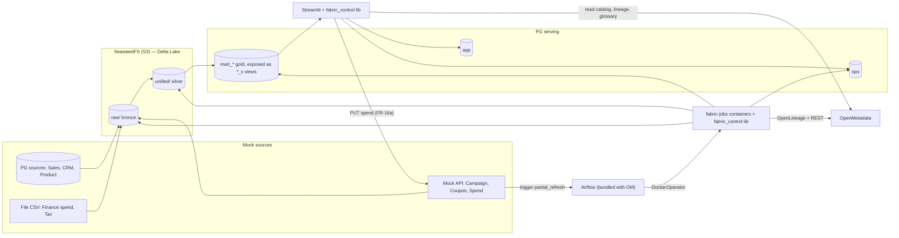
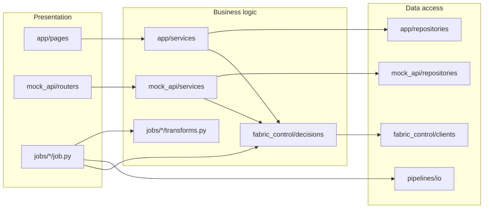
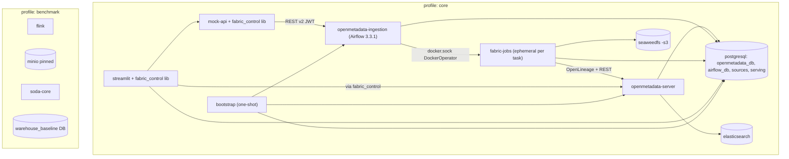
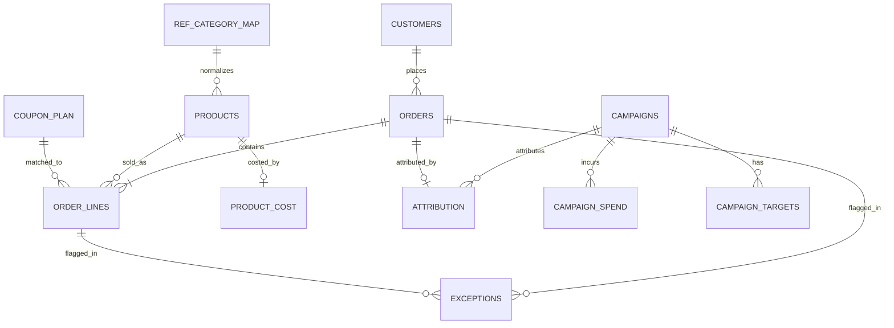

# Architecture Spine — Marketing Data Fabric Demo

## Design Paradigm

- **Data plane — pipes-and-filters following the medallion pattern.** Data flows in one direction: *sources → `raw` (bronze) → `unified` (silver) → `mart_*` (gold) → app*. Each step is an independent job that writes exactly one dataset.
- **Control plane — active metadata.** OpenMetadata (OM) stores metadata. `fabric_control` is the *only* library that reads/writes metadata and makes decisions based on it (whether to keep writing or block, what to refresh, what permissions to grant). Airflow only orchestrates.
- **Inside each code unit — 3 layers.** Presentation → Business logic → Data access (AD-14).



## Invariants & Rules

### AD-1 — One-directional data flow, no layer skipping [ADOPTED]

- **Binds:** every job, app
- **Prevents:** shortcut reads from the source/raw that break lineage and cause numbers to mismatch across pages
- **Rule:**
  - `raw` reads only from the source.
  - `unified` reads only from `raw` or `unified`.
  - `mart_*` reads only from `unified` or `mart_shared`.
  - Streamlit reads only the `*_v` schema views (AD-8) and calls `fabric_control`.
  - Streamlit never reads SeaweedFS, source DBs, or the underlying mart tables.

### AD-2 — OM is the metadata system of record; metadata enters OM via code [ADOPTED]

- **Binds:** FR-10..FR-15, BR13, BR16, R16
- **Prevents:** two sources of truth for metadata; manual edits in the OM UI drifting from the repo
- **Rule:**
  - OM 2.0.2 stores catalog, glossary, tags, lineage, and DQ results.
  - The OM UI is for admins only. Users view catalog, glossary, search, and lineage **inside Streamlit**, through `fabric_control`'s read functions.
  - Paths for writing into OM:
    - Lineage emitted by Spark: OpenLineage `POST /api/v1/openlineage/lineage`.
    - Lineage Spark cannot see (e.g. input from an API), and Delta table registration when the connector is insufficient (S1): `fabric_control.emit_lineage` / `register`.
    - Glossary, tags, mappings: `fabric_control.sync_*` reading from `governance/`.
  - The `Provenance.Synthetic` label is set at the raw layer from the source's `Provenance` column, then **propagates down through lineage**: every descendant dataset and every term is counted as Synthetic if it has a Synthetic ancestor. This is computed by `sync_glossary()`, never assigned by hand.
  - GX's `OpenMetadataValidationAction` is not used.

### AD-3 — `fabric_control` is the sole API to metadata and orchestration [ADOPTED]

- **Binds:** every job, DAG task, UI page, mock API
- **Prevents:** each unit calling OM or Airflow directly and reimplementing its own lineage logic, DQ scoring, or policy
- **Rule:**
  - Only `fabric_control/clients` calls OM, the Airflow REST API, and PG admin. Every other unit uses only the functions below, parameterized by `dataset_id` / `job_id` (AD-18).
  - A stub with this exact signature is committed in week 1.
  - `FABRIC_CONTROL_MODE=offline` turns every OM/Airflow call into a no-op with local logging, used for the `dev` profile.

| Group | Function |
|---|---|
| Run job | `run(job_id, scope) → Run` (context manager); `Run.run_id`; `Run.record_change(dataset_id, before, after)` |
| DQ | `check(dataset_id, df, scope) → DQResult`; `score(DQResult) → (pct, status)` (pure function); `report_dq(DQResult)`; `gate(DQResult)`, raise `GateFailed` |
| Refresh | `affected_by(event) → [ {dataset_id, job_id, scope} ]` (topological order); `status(dataset_id) → {stale, since, cause}` |
| Policy | `sync_policies()`; `verify_policies()`; `can_export(dataset_id, role) → (bool, reason)` |
| Metadata write | `sync_glossary()`; `sync_tags()`; `emit_lineage(...)`; `register(dataset_id)` |
| Metadata read | `catalog(filter)`; `search(q)`; `term(term_id)`; `lineage(dataset_id, depth)`; `latest_score(dataset_id)`; `effective_matrix()` |
| Operations | `trigger(dag_id, conf)`; `record_timing(page, ms)` |

### AD-4 — Every dataset has exactly one writer, both in code and in time [ADOPTED]

- **Binds:** every dataset, AD-12
- **Prevents:** two jobs or two concurrent runs writing to the same table; Delta on S3 has no put-if-absent, so concurrent writes corrupt the log
- **Rule:**
  - Each dataset's writer is declared in `contracts/datasets.yml` (AD-18).
  - Sources: seed script + mock API.
  - `raw`: the ingest job for that source, append-only.
  - `unified`, `mart_*`: exactly 1 job.
  - `app.*`: Streamlit (user `app_writer`, each table owned by one slice).
  - `ops.*`: `fabric_control`.
  - Every data-writing DAG shares the Airflow pool `fabric_writes` (slots=1) with `max_active_runs=1`.
  - The derived table at the source (`Spend_Recon`) must never be read as a fact. Reconciliation is recomputed in `mart_shared.spend_reconciliation` (FR-4).

### AD-5 — Business changes enter from the source side [ADOPTED]

- **Binds:** FR-16, FR-16a, BR16
- **Prevents:** the app editing the lake or mart directly and losing versioning and lineage; other roles being able to edit spend
- **Rule:**
  - Only the mock API accepts changes (`PUT`).
  - The mock API accepts only roles with write permission per `access_matrix.yml` (only UG04 may edit spend).
  - The mock API checks the source's invariants (0 ≤ allocation ≤ that day's online spend, the date falls within the campaign period). Violations return a 4xx with a reason.
  - Each successful write increments that source's `source_version`, then calls `fabric_control.trigger("partial_refresh", event)`.
  - The event has the shape `{event_id, emitted_at, source: <dataset_id raw>, keys: {…}, source_version}`.
  - No other path may trigger `partial_refresh`.

### AD-6 — Key-scoped refresh contract [ADOPTED]

- **Binds:** FR-16, FR-18, BR10, BR11, BR12, BR16, NFR-4
- **Prevents:** a mart receiving the wrong grain scope (e.g. computing whole-campaign attainment from a single day); old rows being missed; `_refreshed_at` of unrelated metrics being changed
- **Rule:**
  - **Manifest.** Every mart has a `mart.yml` containing:
    - `table`
    - `grain` (the PK columns, in order)
    - `modes: [full] | [full, scope]`
    - `scope_map`: event key → column or derivation within the grain (e.g. `date → period_month`, `campaign_id → channel` via `unified.campaigns`). A key absent from `scope_map` does not narrow the scope.
    - `metrics`: the columns tagged with a glossary term.
  - **Scope.** Comes in two JSON shapes:
    - `{"mode":"full"}`
    - `{"mode":"scope","keys":{"<col>":[v…]}}`, an AND of IN-lists
  - Scope is passed to the job via `--scope` and written verbatim into `ops.runs.scope`.
  - `affected_by` reads only OM lineage and the manifests. It returns a list in topological order (`unified` → `mart_shared` → the slice's mart), with scope projected onto each dataset's grain.
  - **Scoped write** = recompute *all* the grain rows matching the scope (reading whatever upstream data those rows need), then replace them in a single transaction:
    - PG: `io.upsert_pg(table, df, scope)` = `DELETE WHERE scope` + `INSERT`.
    - Delta: `io.write_delta(..., replace_where=scope)`.
    - Rows outside the scope are left untouched.
  - Marts that don't sit downstream of campaign/spend need only `full`.
  - **Before/after.** `upsert_pg` returns `(before, after)`, read `FOR UPDATE` in the same transaction. `job.py` calls `run.record_change(...)`. `fabric_control` writes `ops.metric_change_log(run_id, event_id, dataset_id, grain_key jsonb, term_id, old_value, new_value)` for the `metrics` columns. The unified job writes the Delta version before/after into `ops.runs`.

### AD-7 — DQ gate before write; exceptions are data [ADOPTED]

- **Binds:** FR-7, FR-8, FR-9, FR-17, BR14
- **Prevents:** bad numbers reaching the dashboard; quality scores computed differently in different places; exception IDs changing after every rerun and losing processing state
- **Rule:**
  - **Running DQ.** Every job writing `unified` or `mart` calls `check()` on the DataFrame *before writing*.
    - `check()` runs GX Core with the rules in `dq/<dataset>.yml`. Each rule has a `rule_id` (unique within the file), an `expectation`, and `severity: critical|warning`.
    - In scope mode, table-level rules (uniqueness, row-count, referential) run on the *post-merge image*: rows outside the scope ∪ the newly computed rows.
  - **Scoring and reporting.**
    - `score()` computes the score per FR-7.
    - `report_dq()` writes `ops.dq_results`, which is the sole data source for the UI. It also pushes to OM via `POST /api/v1/dataQuality/testCases` (created once, FQN = `<om_fqn>.<rule_id>`) and `POST /api/v1/dataQuality/testCases/testCaseResults/<fqn>`. A failure pushing to OM must not block the job.
  - **Gating.** If `gate()` fails on a critical rule, the job stops and does not write. AD-19 handles displaying the resulting stale state.
  - **Rule ownership.** P4 owns the *standard* for rules; P3 owns the DQ & Exceptions page. Each `dq/*.yml` file belongs to that job's owner, reviewed by P4.
  - **Exceptions (FR-8).** Each job that detects exceptions writes to its own `unified/exceptions_<class>` dataset, following the shared `contracts/exceptions.yml` schema.
    - `exception_id = sha1(class || '|' || natural_key canonical)`, stable across reruns.
    - `mart_shared.exceptions` (P1) merges these datasets and is the only place the UI reads from.
    - `app.exception_status` is keyed by `exception_id`. If an ID disappears, the displayed status is "resolved at source".

### AD-8 — Enforcement of permissions inside Postgres, generated from tags, fail-closed [ADOPTED]

- **Binds:** FR-14, FR-19..FR-22, BR08, BR11, BR14, NFR-9
- **Prevents:** permissions only hidden in the UI; hand-written `GRANT`s drifting from tags; each slice guessing view names differently; sensitive data leaking through `app` or `ops`
- **Rule:**
  - **Connections.** Each group UG01..UG06 has its own PG login (credentials in `.env`). The role switcher swaps connections, not `SET ROLE`.
  - **Query surface.**
    - Underlying tables in `mart_*`, `app`, `ops` are never granted to any UG login.
    - `sync_policies()` generates exactly one view per exposed table: `<schema>_v.<table>`, with the same column names, shared by every role.
    - The repository only queries the `*_v` schemas, with an explicit column list.
  - **Policy vocabulary.**
    - `tags.yml` defines an action per tag × role, drawn from the set {`allow`, `mask:<fn>`, `deny`}. Mask functions live in a closed list in `fabric_control`; a guest identity uses `mask:partial` → `C****42`.
    - `deny` returns NULL, plus a `<col>__denied` flag column. When the UI sees this flag it displays "not permitted for role".
    - No privilege on the view → PG returns `permission denied` → UI shows the same message.
  - **Fail-closed.** Every serving column must have a tag (declared in `contracts/`). If any column is still untagged, `sync_policies()` fails.
  - **Verification.** After applying, `sync_policies()` writes `ops.policy_effective(role, dataset_id, column, action)`. `verify_policies()` cross-checks this table against `has_column_privilege` and the view's actual output. The FR-22 matrix reads from `ops.policy_effective`.
  - **`app` and `ops` tables hold sensitive data too.** Tables containing guest identifiers or metric values (`app.segments`, `ops.metric_change_log`) are tagged and go through the same policy.
  - **Data export (FR-21).** Exporting a contact list is a policy capability: `can_export()` returns `False` when the dataset has no consent metadata. No contact-export view is ever granted.
  - Every object generated by the generator has the prefix `policy_` and the comment `generated-by sync_policies`. Only `sync_policies()` may drop or recreate them.

### AD-9 — Storage only through the S3 API; raw is immutable; reads pin the correct version

- **Binds:** FR-2, FR-3, FR-6, FR-18, NFR-5, NFR-6
- **Prevents:** code coupling to one storage product; reloads duplicating rows; reruns producing different results
- **Rule:**
  - **Storage.** All object storage access goes only through the S3 API (`s3a://` path-style, boto3). Swapping SeaweedFS ↔ MinIO is only a config change.
  - **Raw.** `raw` and `unified` are Delta tables. `raw` is append-only; each load carries `_load_id`, `_ingested_at`, `_source`, `_load_kind: snapshot|delta`, `_source_version`, `_schema_version` (AD-22).
  - **Source version.** `source_version` is a monotonically increasing integer *per source*:
    - the mock API increments it on every `PUT`;
    - the DB and files increment it on every seed.
  - **Reconciliation on load (FR-3).** The ingest job compares row counts and checksums between the source and raw, then checks against `governance/baselines.yml`. It also runs the schema gate (AD-22). The result is written to `ops.load_reconciliation`. A load that fails reconciliation must not be used.
  - **What unified reads.** The `unified` job reads via `io.read_raw(...)`: the *latest version per natural key*, taken only from loads that passed reconciliation.
  - **Version lineage.** A mart's `_source_version` column is a `jsonb {dataset_id: source_version}` of the inputs used.
  - **Determinism.** Rerunning `full` with the same `source_version`s must produce identical results in every column that does **not** start with `_`.
  - **Mapping.** Reference mappings (category, R13) live in `governance/mappings/*.yml`, materialized as `unified/ref_<name>` with lineage.

### AD-10 — PostgreSQL layout

- **Binds:** every mart, AD-8, AD-17
- **Prevents:** metric tables without an owner; mixing OM's database with project data
- **Rule:**
  - There is exactly one server: the OM 2.0.2 postgresql image (postgres 15), unmodified.
  - The server has 4 logical databases, each with its own user:
    - `openmetadata_db` and `airflow_db` (created by the OM image);
    - `sources` and `serving` (created by `.sql` files mounted into `/docker-entrypoint-initdb.d`).
  - `sources` is not migrated. It is mock data, and its DDL lives only in `compose/pg-init/`. Changing a source table means editing `pg-init`, the seed, and the `raw` contract (AD-22), then running `make reset`.
  - Schemas within `serving`:
    - `mart_campaign`, `mart_customer`, `mart_finance`, `mart_shared`;
    - `app`, `ops`;
    - each schema above has a corresponding `*_v` schema, generated by `sync_policies`.
  - `warehouse_baseline` (NFR-10) exists only in the `benchmark` profile.

### AD-11 — Vertical slices never read each other's marts; shared metrics are computed once

- **Binds:** P1..P4, `contracts/`
- **Prevents:** two slices computing the same metric two different ways (BR02 and BR11 producing two values tagged differently)
- **Rule:**
  - A slice's mart reads only `unified` and `mart_shared`.
  - Every metric shown by ≥2 slices lives in `contracts/shared_metrics.yml` and is computed only in `mart_shared`. Slices only aggregate it further, never recompute it from `unified`.
  - Minimum from week 1:
    - `mart_shared.campaign_attributed_daily` (`campaign_id × date`: attributed_orders, attributed_gross_value, buyers, first_observed_buyers) — P2
    - `mart_shared.campaign_spend_allocated` (`campaign_id × date`: allocated, unallocated) — P4
    - `mart_shared.spend_reconciliation` — P4
    - `mart_shared.exceptions` — P1
    - `unified/product_cost` — P3
  - The schema of `unified` and `mart_shared` is published in `contracts/` before any code is written. Changes must go through a PR, approved by the dataset owner and every slice that consumes it.

### AD-12 — One orchestrator; DAGs contain no logic; jobs run in their own image

- **Binds:** every pipeline, NFR-1, NFR-2
- **Prevents:** a second Airflow; Python/Java dependencies breaking the Airflow image because OM pins its version; everyone installing jars differently
- **Rule:**
  - **Orchestrator.** Airflow 3.3.1 inside OM's ingestion image is the only orchestrator, unmodified.
  - **DAG.**
    - DAGs are mounted from `pipelines/dags`.
    - DAGs import only the Airflow SDK, never `fabric_control`.
    - There are 3 DAGs: `full_refresh`, `partial_refresh`, `reload_source`.
    - The first task of `partial_refresh` is a `fabric-jobs` container running `affected_by(event)`. The result is returned via XCom, and dynamic task mapping then generates the job tasks in the correct order.
  - **How jobs run.**
    - Each task runs the `fabric-jobs` image via `DockerOperator` (`spark-submit --master local[*]`). The container removes itself when done.
    - Compose mounts `/var/run/docker.sock` into the ingestion container, with an appropriate `group_add`. The image is unmodified.
  - **The `fabric-jobs` image.** All jars are baked into the image; nothing uses `--packages` at runtime. `openmetadata-ingestion` is never installed into `fabric-jobs`.

### AD-13 — Operations are recorded through a single path

- **Binds:** FR-23..FR-26, BR15, NFR-4
- **Prevents:** the ops page reading Airflow's internal DB; partial-refresh latency being unmeasurable
- **Rule:**
  - Every job runs inside `with fabric_control.run(job_id, scope) as run:`.
  - `run()` writes `ops.runs` containing:
    - `run_id`, `job_id`, `event_id`, `scope`;
    - start/end time, rows in/out;
    - `status: success|failed|gated`, the failing step;
    - Delta version;
    - `schema_versions` of inputs and outputs (AD-22).
  - Errors are written to `ops.alerts` and then re-raised.
  - Partial-refresh latency = `max(ended_at) − emitted_at` per `event_id`.
  - Page response time (FR-26): measured by the shell, which then calls `record_timing()` to write `ops.page_timings` using the `ops_writer` credential held inside the library.
  - The ops page reads only `ops_v`. Reload (FR-24) uses `trigger()`.

### AD-14 — 3 layers within every code unit [ADOPTED]

- **Binds:** `app/`, `mock_api/`, `pipelines/jobs/`, `fabric_control/`
- **Prevents:** SQL embedded in UI pages; transforms doing IO so they can't be unit tested; pages holding their own DB connections and bypassing permissions
- **Rule:**
  - Dependencies flow only as shown in the diagram below. Only the Data access layer opens connections (PG, S3, OM, Airflow).
  - A transform is a pure DataFrame → DataFrame function, never calling `io`.
  - The one exception: `job.py` is the assembly point, allowed to call `io` (read, write) and `fabric_control` (`run`, `check`, `gate`).



### AD-15 — Profiles and resource budgets

- **Binds:** NFR-1, NFR-2, NFR-5, NFR-10
- **Prevents:** benchmark components running alongside the demo and exceeding 12GB; P2–P4 having to run the whole stack just to work
- **Rule:**
  - **`docker compose` profiles:**
    - `core` (default): the full demo.
    - `dev`: PG, SeaweedFS, streamlit; jobs run manually; `fabric_control` in offline mode; sample data from `contracts/fixtures/<dataset_id>.parquet` (generated by P1 in week 1).
    - `benchmark`: Flink, Soda, a pinned MinIO build (source image specified), a traditional warehouse pipeline.
  - The ×10/×100 replicated data lives only under the `bench/` prefix.
  - **RAM limits** (`mem_limit`) for the `core` profile, totaling ≤ 12GB. `.wslconfig` sets memory=14GB.

| Service | mem_limit |
|---|---|
| openmetadata-server | 2GB |
| elasticsearch (heap 1GB) | 1.5GB |
| postgresql | 1GB |
| openmetadata-ingestion (Airflow) | 2GB |
| seaweedfs | 0.5GB |
| mock-api | 0.25GB |
| streamlit | 0.5GB |
| fabric-jobs (max 1 container writing at a time, `driver.memory=2g`) | 3GB |

### AD-16 — Glossary and policy are code; metrics are shown only through `shell.metric`

- **Binds:** FR-11, FR-12, FR-14, BR13, BR14, R6, R7, R9, R10, R11, R14, R16
- **Prevents:** metrics without a definition; two slices defining the same term differently; every page writing its own explanatory notes
- **Rule:**
  - **One glossary.** OM has exactly one glossary, `marketing_metrics`.
  - **Term ID** = the metric's canonical column name: `snake_case` of the English display name, with `/` → `_per_` (e.g. `attributed_value_per_spend_ratio`).
  - **Term fields:**
    - `display_name`, `owner_slice`, `dataset_id`, `column`;
    - `rules: [R…]`;
    - `limitations`, `notes: [currency_unverified | retrospective_target | estimate_not_profit | attributed_not_incremental | first_in_observed_history]`.
  - **Declaration.** Each term is declared in exactly one `governance/glossary/<slice>.yml` file. Terms for metrics in `mart_shared` live in `platform.yml`, or in the file of the slice that owns that table. `sync_glossary()` fails on duplicate IDs or duplicate display names.
  - **Display.** A page shows a metric only through `shell.metric(term_id, value, freshness)`. This function renders the label, value, freshness/stale/synthetic badge, notes, and a link to open the definition (FR-12). No page writes its own note strings.
  - The e2e test fails if any `term_id` does not exist.
  - **Ownership.** `tags.yml`, `access_matrix.yml`, and `baselines.yml` are owned by P4 (decisions). The `sync_*` code is owned by P1 (execution).

### AD-17 — Serving DDL is owned by migrations; jobs never run DDL

- **Binds:** every `mart_*`, `app`, `ops` table; AD-6, AD-8
- **Prevents:** Spark JDBC `overwrite` dropping a table and losing GRANTs, views, PKs, and data types
- **Rule:**
  - Tables are created only by version-numbered SQL files in `migrations/<schema>/NNN_*.sql`, matching `contracts/` and `mart.yml`: PK = `grain`, types per Conventions. The schema owner writes the migration, P1 reviews. In schemas written by several owners (`mart_shared`, `app`, `ops`), migration numbers are reserved per owner to avoid collisions: P1 `001–099`, P2 `100–199`, P3 `200–299`, P4 `300–399`, filename `NNN_<owner>_<desc>.sql`.
  - **Runner: yoyo-migrations.** Migrations are plain SQL files applied by yoyo; there is no Alembic and no ORM. yoyo tracks each file independently (tables `_yoyo_migration`, `_yoyo_log`, `_yoyo_version`, `yoyo_lock` in `serving.public`), so parallel owners never create competing heads.
    - `migrations/yoyo.ini` lists every schema directory as a source, plus `batch_mode = on`. The DSN is not stored in the file; it uses the psycopg 3 driver: `postgresql+psycopg://…/serving`.
    - `fabric_control.run_migrations()` (P1) calls the Python API: `get_backend(dsn)` → `read_migrations(...)` → `with backend.lock(): backend.apply_migrations(backend.to_apply(...))`. It does not call `sync_policies()` itself, because tags may not be synced yet: in bootstrap, policies are synced at steps 6–8 (AD-20); `make migrate` runs `run_migrations()` → `sync_tags` → `sync_policies`. It is idempotent and is the only way migrations run: bootstrap step 5 (AD-20), `make migrate`, and CI. The CLI (`yoyo list`, `yoyo rollback -r <id>`) is for local dev only.
    - Each file runs in one transaction; order is `-- depends:` first, then file name.
  - **Migration rules.**
    - The migration id is the file name without its extension, and must be unique across all of `migrations/`. Put the table or subject in `<desc>` (e.g. `101_p2_campaign_attributed_daily`); two directories must never both contain the same migration id.
    - `migrations/_platform/000_p1_create_schemas.sql` creates every serving schema (`CREATE SCHEMA IF NOT EXISTS`). Every other migration declares `-- depends: 000_p1_create_schemas`, plus the id of any migration that owns an object it references in another owner's range or schema.
    - DDL always uses schema-qualified names (`mart_shared.x`); nothing relies on `search_path`.
    - An applied migration is never edited, because yoyo identifies it by id, not content. A schema change is a new file (`ALTER TABLE …`) in the same PR as the `contracts/` change (AD-11).
    - Every migration ships `<id>.rollback.sql`. Exception: `000_p1_create_schemas`.
  - **CI check.** On an empty PG: `apply` all → `rollback` all → `apply` all. Then compare `information_schema.columns` (name, type, nullability, PK) of every serving table against `contracts/` and `mart.yml`, and check that migration ids are unique. Any mismatch fails the build.
  - Jobs write only through `pipelines/io`:
    - `write_pg_full` = `TRUNCATE` + `INSERT` in one transaction;
    - `upsert_pg` per AD-6.
  - `DROP`/`CREATE`/`ALTER` are forbidden in jobs, as is JDBC `overwrite`.
  - `sync_policies()` runs after every migration run and at the end of `full_refresh`.

### AD-18 — One identity registry

- **Binds:** every `fabric_control` API, DAG, OpenLineage, `ops`
- **Prevents:** dataset, job, and run names diverging between OM, OpenLineage, `ops`, and the DAG, so `affected_by` can't map lineage back to the job that needs to rerun
- **Rule:**
  - `contracts/datasets.yml` (P1) is the single logical registry, assembled by `fabric_control` from per-owner fragments `contracts/datasets/{platform,campaign,customer,finance}.yml` (each fragment edited only by its owner, so slices never conflict on one file). It lists every dataset with fields: `dataset_id`, `om_fqn`, `openlineage {namespace, name}`, `job_id` (the writer), `owner`, `tags`.
  - `dataset_id` shape: `raw/<source>/<table>` · `unified/<entity>` · `mart_<subject>.<table>`.
  - `job_id` = the job's directory path (e.g. `marts/finance/budget_daily`), and is also the DAG's task id.
  - `run_id` = `<dag_run_id>:<job_id>`, written by `io` into the `_run_id` column.
  - Only `fabric_control/clients` translates to OM or OpenLineage names.
  - CI checks that every output declared in `job.py` exists in the registry.

### AD-19 — Freshness is computed per displayed value; stale state propagates through lineage

- **Binds:** FR-11, FR-17, BR16, T-BR16
- **Prevents:** a badge taking the job's run time for every campaign, breaking the check "other metrics keep their existing refresh time"; stale warnings not reaching downstream pages
- **Rule:**
  - **Freshness** of a displayed value = `max(_refreshed_at)` over exactly the mart rows that produced that value. The repository returns freshness alongside the value. `_refreshed_at` changes only when a row is rewritten.
  - **Stale.** A dataset is considered stale when its most recent run has `status='gated'`, **or** an ancestor dataset in its lineage is stale.
    - Only `status()` answers this question. It caches lineage per DAG run.
    - Stale state ends once the blocked dataset is written successfully.
  - The DAG skips descendant tasks of a blocked dataset.

### AD-20 — Single-command, idempotent bootstrap

- **Binds:** NFR-1, NFR-6, SM5
- **Prevents:** manual steps (copying an OM token, registering a service) breaking "runs with no manual fixes"
- **Rule:**
  - A one-shot `bootstrap` service (P1, `fabric-jobs` image) with `depends_on: service_healthy`. It runs the following steps in order, each idempotent:
    1. Create PG init.
    2. Seed sources from xlsx.
    3. Fetch an OM bot token via REST using admin creds from `.env`, then write it to a secret volume.
    4. Register services in OM.
    5. Run migrations: `fabric_control.run_migrations()` (yoyo, AD-17).
    6. `sync_tags` → `sync_glossary`.
    7. `full_refresh`.
    8. `sync_policies` → `verify_policies`.
  - `docker compose up` is considered done when `bootstrap` exits with code 0.
  - `make reset` = delete the volume, then rerun bootstrap.
  - PG, SeaweedFS, and ES use named volumes.

### AD-21 — Testing strategy

- **Binds:** NFR-3, NFR-7, SM2, SM3, T-BR01..T-BR16
- **Prevents:** everyone writing tests their own way; no single command to see "all green"
- **Rule:**
  - **Unit** (`tests/unit`): tests `transforms.py` and `services` against fixtures. Written by the code's owner.
  - **Reconcile** (`tests/reconcile/test_br<nn>.py`):
    - Independent SQL against `unified`, compared to the value in `*_v`. Does not import mart code.
    - Written by someone other than the mart's author.
    - Hard-asserts the PRD §6 benchmarks (52,924 · 26,631 · 1,468 · 1,290 · 0 · 1,319 shared transaction codes · 400 coupon-mismatch lines / 126 `Used`).
    - Comparison ignores columns starting with `_`.
  - **E2e** (`tests/e2e/test_br<nn>.py`, or `test_br<nn>_<area>.py` when a BR spans multiple owners):
    - Written by the slice that owns the BR.
    - Runs pytest against the `core` stack after bootstrap, asserting through `app/services`, plus one Streamlit `AppTest` smoke test per page.
  - A single `make test` command (P1). Must be green before merging to `main`.

### AD-22 — Schemas are versioned in contracts; drift is caught at the boundary

- **Binds:** `contracts/`, every `raw`, `unified`, `mart_*` dataset; AD-7, AD-9, AD-11, AD-13, AD-17, AD-19
- **Prevents:** a source silently renaming a column and breaking every downstream job; a Delta schema changing just because a job's DataFrame changed; no way to tell which schema a run used
- **Rule:**
  - **The contract is the schema of record.** Every dataset in the registry (AD-18) has `contracts/schemas/<dataset_id>.yml` with `schema_version` (semver `MAJOR.MINOR.PATCH`), `columns: [{name, type, nullable, tag}]`, and `grain` for marts. It is edited by the dataset's owner in the registry. For `raw/*`, the contract describes the source as it must arrive.
  - **What each bump means.**
    - `PATCH`: descriptions or tags only; no column changes.
    - `MINOR`: add a nullable column. Existing consumers keep working unchanged.
    - `MAJOR`: remove or rename a column, change a type or nullability, or change `grain`. Needs approval from every consuming slice (AD-11); consumers are updated in the same release.
    - CI compares every changed contract with `main` and fails if the column change and the bump level don't match.
  - **Ingest gate (source → raw).** Before writing, `jobs/ingest` compares the source's columns and types with the `raw` contract:
    - a missing, renamed, or retyped column → the load fails with `reason='schema_drift'` in `ops.load_reconciliation`, an entry in `ops.alerts`, and run `status='gated'`, so descendants go stale via AD-19;
    - an extra column in the source → the load continues without that column and writes a warning to `ops.alerts`; the column is ingested only after a `MINOR` contract bump.
  - **Delta writes (`raw`, `unified`).** `io.write_delta` checks the DataFrame against the dataset's contract and fails before writing on any mismatch. Jobs never enable Delta auto-merge or `overwriteSchema` themselves.
    - `MINOR`: `io` turns on `mergeSchema` for that one write, only when the contract has a column the table doesn't have yet. Old rows read the new column as NULL.
    - `MAJOR` on `unified`: applied by a `full` refresh from its single writer, which rewrites the table with `overwriteSchema`. Older versions stay readable through Delta time travel.
    - `MAJOR` on `raw`: raw is immutable (AD-9), so the change becomes a new dataset `raw/<source>/<table>_v<MAJOR>`, added to the registry (AD-18). The `unified` job reads both and maps the old shape onto the new one.
  - **Postgres serving.** A contract change for a `mart_*`, `app`, or `ops` table ships in the same PR as its yoyo migration (AD-17); AD-17's CI check confirms the two match.
  - **Recording.**
    - Raw rows carry `_schema_version` (AD-9).
    - `ops.runs` records `schema_versions jsonb {dataset_id: schema_version}` for every input and output (AD-13).
    - `fabric_control` pushes `schema_version` to OM as a table custom property, so the catalog shows it alongside OM's own version history.
  - **Demo (BR15).** `sources/` has a `schema_drift` fault toggle that renames one column in a source file. The ingest gate must block the load, and the affected pages must show as stale.

## Consistency Conventions

| Concern | Convention |
| --- | --- |
| Naming | English `snake_case`; `dataset_id` shape per AD-18 |
| Keys | `order_key = customer_id || '|' || transaction_id` (R1); always keep the source code alongside; `customer_id`, `campaign_id`, `sku` kept as in the source; the as-of cutoff date `AS_OF_DATE = 2019-12-31` is a constant in `contracts/constants.yml` |
| Core measures | `unified/orders` holds `gross_value` (R2) and `shipping_fee` (once per order, R3); `unified/customers` holds `first_observed_order_date` (R9) |
| Metadata columns | raw: per AD-9; mart: `_refreshed_at`, `_run_id`, `_source_version`; any column starting with `_` is excluded from deterministic comparison or reconciliation |
| Date / money | `DATE` / ISO-8601; money as `NUMERIC(18,2)`, no currency label or suffix (R10) |
| Events, scope | Per AD-5 and AD-6 |
| DQ rules | Per AD-7 |
| Config / secrets | Only via environment variables / `.env`; commit `.env.example`; no hard-coding (NFR-9) |
| Errors | Jobs raise; `run()` logs an alert then re-raises; the UI shows "not permitted for role" for permission errors and the `__denied` column, and never swallows errors |
| UI language | English (NFR-8) |
| Ownership | Each person edits only their own directory (see Structural Seed); the story lead coordinates delivery but does not take over a co-owner's directory. Changes to `contracts/`, `fabric_control/`, `pipelines/io/`, `app/shell/` must go through a PR approved by the owner. Shared registries are split into per-owner fragments so no two people edit the same file: `contracts/datasets/<slice>.yml`, `governance/glossary/<slice>.yml`, `governance/tags/<slice>.yml` (P4 approves every tag PR; `tags.yml` = union of fragments), and each slice's page list in `app/pages/<slice>/registry.py`, which the shell imports and filters by role (slices never edit `app/shell` to add pages). A story's co-owner part lives in the co-owner's directory and is delivered as its own PR against an interface already published in `contracts/` or a `fabric_control` stub |

## Stack

| Name | Version |
| --- | --- |
| OpenMetadata server / ingestion / postgresql (`docker.getcollate.io/openmetadata/*`) | 2.0.2 (PG = postgres 15) |
| Airflow (inside OM's ingestion image) | 3.3.1, Python 3.12, SimpleAuthManager; REST `/api/v2` + JWT (`POST /auth/token`); providers-docker 4.5.9 |
| Elasticsearch | 9.3.0 (heap 1GB) |
| Apache Spark / PySpark | 3.5.9, Scala 2.12 |
| Delta Lake (`delta-spark`, `io.delta:delta-spark_2.12`) | 3.3.3 |
| hadoop-aws / aws-java-sdk-bundle | 3.3.4 / 1.12.262 |
| PostgreSQL JDBC | 42.7.x |
| OpenLineage (`openlineage-spark_2.12` / `openlineage-python`) | 1.53.0 / 1.53.0 |
| Great Expectations (GX Core) | 1.23.2 (numpy<2 in fabric-jobs) |
| SeaweedFS | 4.47 |
| Python (fabric-jobs, app, mock_api) | 3.11 |
| Java (fabric-jobs) | 17 |
| Streamlit / FastAPI / psycopg | 1.64.0 / 0.141.1 / 3.3.6 |
| yoyo-migrations (in `fabric-jobs`) | 9.0.0 |
| Benchmark only: Apache Flink, Soda Core, MinIO (last community build) | pinned when the `benchmark` profile is built |

## Structural Seed

**Container & deployment (a single environment: local, `docker compose`).**



**Core entities (unified layer).**



**Directory tree and owners.**

```text
marketing-fabric/
  compose/                  # P1 — docker-compose.yml (core|dev|benchmark), .env.example, pg-init/*.sql, bootstrap
  migrations/               # yoyo.ini, _platform/000_p1_create_schemas.sql — P1; <schema>/ written by the schema owner, P1 reviews (AD-17)
  contracts/                # datasets.yml, shared_metrics.yml, exceptions.yml, constants.yml, schemas, fixtures/ — P1
  governance/
    glossary/<slice>.yml    # platform(P1) campaign(P2) customer(P3) finance(P4)
    tags.yml  access_matrix.yml  baselines.yml   # P4
    mappings/*.yml          # P1
  fabric_control/           # P1 — decisions/ (business), clients/ (OM, Airflow, PG admin)
  mock_api/                 # P1 — routers/ services/ repositories/
  sources/                  # P3 — seed xlsx → PG sources, files, mock_api data files (format in contracts/); fault toggles for BR15 demo, incl. `schema_drift` (AD-22)
  pipelines/
    dags/                   # P1 — full_refresh, partial_refresh, reload_source
    io/                     # P1 — read_raw, write_delta, write_pg_full, upsert_pg
    jobs/                   # each job: job.py, transforms.py, dq/*.yml, (mart) mart.yml
      ingest/<source>/      # P1
      unified/<entity>/     # sales/customer/product/ref mappings → P3; campaign/attribution/coupon/targets → P2; campaign_spend → P4
      marts/shared/         # campaign_attributed_daily → P2; exceptions → P1; campaign_spend_allocated, spend_reconciliation → P4
      marts/campaign/       # P2
      marts/customer/       # P3
      marts/finance/        # P4
  app/
    shell/                  # P2 — login, role switcher, conn per role, metric(), timing capture, lineage viewer component, progress strip
    pages/ services/ repositories/
      campaign/             # P2
      customer/  catalog/   # P3 (catalog: catalog, search, glossary, lineage graph)
      governance/           # DQ & Exceptions → P3; policy/access pages → P4
      finance/  ops/        # P4
      changes/              # P2 — BR16 before/after change history
  tests/unit/  tests/reconcile/  tests/e2e/
  benchmark/                # P4
  docs/demo-script.md       # P2 — demo runbook and readiness checklist
```

## Capability → Architecture Map

| Capability / Area | Lives in | Governed by |
| --- | --- | --- |
| BR01, BR02, BR03, BR06, BR12 | `marts/campaign`, `app/*/campaign` — P2 | AD-6, AD-11, AD-16, AD-19 |
| BR05, BR08, BR09 | `marts/customer`, `unified/customers`, `app/*/customer` — P3 | AD-8, AD-11 |
| BR10, BR11 | `marts/finance`, `mart_shared.campaign_spend_allocated`, `spend_reconciliation` — P4 | AD-6, AD-8, AD-11 |
| BR13 · FR-10..FR-13, FR-15 | `fabric_control` read functions — P1; `app/*/catalog` UI/service integration — P3 | AD-2, AD-3, AD-16 |
| BR14 · FR-7..FR-9 | `dq/*.yml` standard — P4; `mart_shared.exceptions` — P1; DQ & Exceptions page in `app/*/governance` — P3 | AD-7 |
| BR14 · FR-14, FR-20, FR-22 | `tags.yml`, `access_matrix.yml`, policy/access pages in `app/*/governance` — P4 | AD-8 |
| BR15 · FR-23..FR-26 | `ops` schema, `app/*/ops` — P4; `run()`, `record_timing()` — P1 | AD-13 |
| BR16 · FR-16, FR-16a, FR-17, FR-18 | `affected_by`, `dags/partial_refresh`, `io.upsert_pg` — P1; `app/*/changes` — P2 | AD-5, AD-6, AD-19 |
| FR-1, FR-2, FR-3 | `sources/` — P3; `mock_api/`, `jobs/ingest`, `ops.load_reconciliation` — P1 | AD-4, AD-9, AD-22 |
| Schema versioning | `contracts/schemas/`, `io.write_delta`, `jobs/ingest` schema gate, `migrations/` — P1; each contract by its dataset owner | AD-17, AD-22 |
| FR-4 | `mart_shared.spend_reconciliation` — P4 | AD-4 |
| FR-5, FR-6 | `unified/orders`, `unified/ref_category_map` — P3 | AD-9, Conventions |
| FR-19 | `app/shell` — P2 | AD-8 |
| FR-21 | `can_export()` — P1; `app/*/customer` UI/service integration — P3 | AD-8 |
| R16 provenance | `Provenance` tag propagated through lineage | AD-2 |
| NFR-1, NFR-6 | `compose/`, bootstrap | AD-20 |
| NFR-2 | `mem_limit`, profile | AD-15 |
| NFR-3, NFR-7 | `tests/` | AD-21 |
| NFR-4 | `ops.runs`, `ops.page_timings` | AD-13 |
| NFR-5, NFR-10 | `benchmark/`, `benchmark` profile — P4 | AD-15 |

## Spikes (week 1, blocking before slice work)

- **S1:** OM 2.0.2 catalog can index a Delta table on SeaweedFS via the Delta connector in storage mode (delta-rs, Endpoint URL field), running inside the stock ingestion image. *Fallback:* `register()` via REST.
- **S2:** an OpenLineage 1.53.0 event from Spark (Delta on s3a, JDBC to PG) maps correctly onto the OM entity with the `om_fqn` from the registry. *Fallback:* `emit_lineage()` via REST.
- **S3:** Spark s3a + Delta 3.3.3 on SeaweedFS with static keys (no session token), path-style, http endpoint. Must support write, overwrite, `replaceWhere`, time travel, and VACUUM. *Fallback:* a pinned MinIO build, config-only change.
- **S4:** measure the `core` profile's RAM while a job is running, must be ≤ 12GB. Measure `partial_refresh` end-to-end time against the < 2 minute target. *Fallback:* chain the scoped jobs inside one `fabric-jobs` container with a single SparkSession, jobs running sequentially, still one writer per job.
- **S5:** a DAG mounted from `pipelines/dags` can run `DockerOperator` (with docker.sock, `group_add`, `mount_tmp_dir=False`) and read XCom. The mock API can trigger the DAG via `/api/v2` with JWT.
- **S6:** bootstrap can fetch an OM bot token automatically; `report_dq()` creates a test case and pushes results onto a registered Delta table.

## Deferred

- The mock API's internal storage — P1's choice; already constrained by AD-4 and AD-5.
- Upgrading to Spark 4.x / Delta 4.x — revisit after S2 if needed. Spark 3.5 is LTS-supported (security patches only) through 11/2027.
- Detailed configuration of Flink, Soda, the traditional warehouse, and catalog/serving alternatives in benchmark — P4's call within the `benchmark` profile; never goes into `core`.
- Moving the UI to React; AI suggestions for UG03; UG07 access via API — stretch.
- Real user authentication (SSO) — out of scope; the demo uses group-based login (AD-8).
- Git branching style — the team's choice; the merge gate is already locked down by AD-11 and AD-21.
- Environments other than local, backups, infrastructure monitoring — out of scope (PRD §10).
